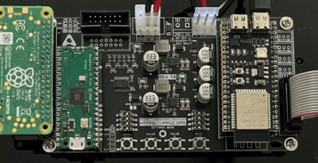
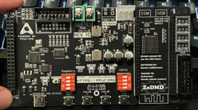

# Legacy firmware

Update guides for the earlier PPUC/DMD generations: REV. 1A, REV. 1B, REV. 1C and REV 2.
These boards were sold by [Jan's Pinball Mods](../distributors.md#janspinballmods).

!!! note "REV 2"
    The steps below are written for REV 1 boards. Instructions specific to REV 2 will be added here.

## Latest versions

| Component | Version | Download |
| --- | --- | --- |
| DMDreader | 0.5.0 | [GitHub release](https://github.com/PPUC/dmdreader/releases/latest), file `dmdreader-ppucdmd.zip` |
| ZeDMDos software | PPUC/DMD 0.4.0 | [Google Drive](https://drive.google.com/drive/folders/1cwbv4Jv_kf0A4cN-hNwA3OxIhp1BoRdx?usp=drive_link), folder `ZeDMDos software files - PPUC/DMD [0.4.0]` |
| Colorizations | `.cROMc` | [Google Drive](https://drive.google.com/drive/folders/1cwbv4Jv_kf0A4cN-hNwA3OxIhp1BoRdx?usp=drive_link), folder `Colorizations` |

## Which board do I have?

Between July 2025 and November 2025, two REV 1 variants were in circulation. The update procedure differs
slightly between them, so check which one you have before you start.

<figure markdown>

<figcaption>REV. 1A / 1B: a Raspberry Pi Pico is attached to the carrier board with soldered pin headers.</figcaption>
</figure>
<figure markdown>

<figcaption>REV. 1C: the Pico (RP2040) is integrated into the carrier board.</figcaption>
</figure>

## How it fits together

A legacy PPUC/DMD has four main hardware components: a Raspberry Pi, an RP2040 (Raspberry Pi Pico),
an ESP32-S3-N16R8 and the PPUC/DMD carrier PCB. Three pieces of software run on them:

- **DMDreader** (RP2040 / Pico) reads the DMD frames from the machine and sends them to ZeDMDos.
- **ZeDMDos** (Raspberry Pi) colorizes the frames and sends them to ZeDMD.
- **ZeDMD** (ESP32-S3-N16R8) sends the colour data to the RGB panels.

You update DMDreader first, then ZeDMDos. Colorization files can be installed or updated at any time.

## What you need

- A Micro SD card reader.
- A USB-C to USB-A cable, or a Micro USB to USB-A cable, depending on the USB port of your RP2040 / Pico.
- Basic computer skills.

## Update DMDreader

1. Download `dmdreader-ppucdmd.zip` from the [latest DMDreader release](https://github.com/PPUC/dmdreader/releases/latest)
   and unzip it. The extracted folder contains `dmdreader-ppucdmd.uf2`, the file you will flash onto the RP2040.
2. Grab a USB cable. For most boards this is a USB-C to USB-A cable; some need Micro USB to USB-A.
3. Turn the game off.

    !!! danger "REV. 1A / 1B: remove the Pico first"
        On REV. 1A and 1B boards you **must** remove the Raspberry Pi Pico from the PPUC/DMD carrier PCB.
        The power trace is directly connected to the Raspberry Pi, so the Pico needs to be removed before you connect it to your computer.

    On a REV. 1C board you can leave everything in place and lay the DMD down for easy access to the USB-C port.

4. Find the button labelled `BOOTSEL` on the Pico or on the REV. 1C board. It puts the RP2040 into flashing mode.
   Hold `BOOTSEL` down while you connect the USB cable from your computer. A drive named `RP2-B2` appears on your computer.
   [Watch a demonstration on YouTube.](https://www.youtube.com/watch?v=os4mv_8jWfU)
5. Drag and drop `dmdreader-ppucdmd.uf2` from step 1 onto the `RP2-B2` drive. Wait a few seconds until the drive disappears.
6. Remove the USB cable. On REV. 1A / 1B boards, plug the Pico back into the carrier board and make sure all pins line up correctly.

## Update ZeDMDos

1. Look at your Raspberry Pi: the larger green board mounted upside down on the left. It carries a number from 1 to 45.
   This number tells you which software file you need.
2. Open the [software folder on Google Drive](https://drive.google.com/drive/folders/1cwbv4Jv_kf0A4cN-hNwA3OxIhp1BoRdx?usp=drive_link),
   go to `ZeDMDos software files - PPUC/DMD [0.4.0]` and download the zip file with your number, for example `12.zip`.
3. All colorization files have been updated to load faster. From the `Colorizations` folder, open the colorization of your
   choice and download its `serum.cROMc` file. Keep the file name exactly as it is.
4. Take the Micro SD card out of your Raspberry Pi and insert it into your computer with a card reader.

    !!! warning "Supporter editions"
        Supporter editions are hardware protected. You have to reuse the same SD card.

5. Follow the [ZeDMDos update video](https://drive.google.com/file/d/12rZP5NDtXh-hpvE5iITfu5ZzG9rINzXC/view) to update the software on the SD card.
6. Put the Micro SD card back into your Raspberry Pi and start the game to check that all is well.

## Install or update a colorization

1. Get the colorization file you want, ideally a `.cROMc` file. A `.cRZ` file also works: extract it like a zip file to get a `.cROM` file.
2. Name the file `serum.cROMc` or `serum.cROM`. Names are case sensitive.

    !!! warning
        A file with any other name is not loaded, and the DMD stays black and white.

3. On the Micro SD card, open the `colorizations` folder and then the `serum` folder. Put your file there.
4. Delete or overwrite any previous colorization file. The `serum` folder should contain only one file.

## Release notes

### DMDreader 0.5.0 (2025-12-01)

[Release on GitHub](https://github.com/PPUC/dmdreader/releases/tag/v0.5.0)

- Fixed SPIKE frame detection.
- Removed STDIO over USB support for easier updates (no `BOOTSEL` required).
- Added Arduino framework support and switched to PlatformIO based builds.
- Simplified clock count programs.
- Blinks at a 500 ms interval while auto-detecting the system.
- Cleaned up buffer handling; the second core is used exclusively for SPI.
- Added alphaDMD support for SAM and SPIKE.

Use `dmdreader-ppucdmd.zip` for PPUC/DMD. `dmdreader-alphadmd.zip` is for alphaDMD.

### PPUC/DMD 0.4.0 (2025-11-23)

- Added support for the `.cROMc` format.
- Faster transmission of incoming frames.
- Faster colorizing and shorter colorization loading times thanks to `.cROMc`.

## Something not working?

Check [When things don't work](../../../docs/ppuc_dmd/when_things_dont_work/) in the documentation,
or ask for help on [Discord](https://discord.gg/fkkk4MbBn5).
